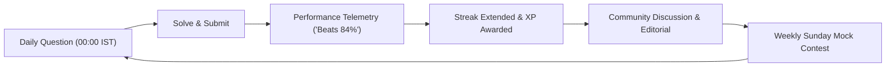
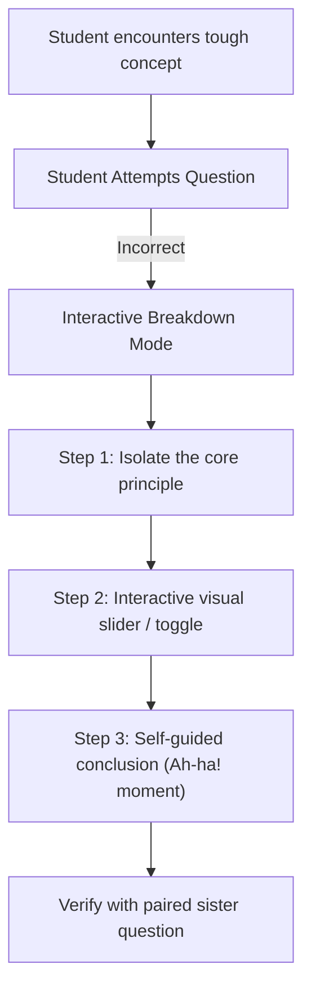
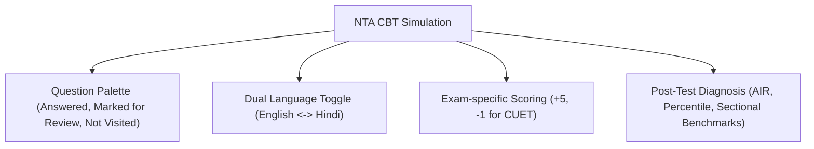

# PadhoBadho Product Requirements Document (PRD)
## The Next-Generation Competitive Exam Platform
### Combining Testbook's Exam Rigor + Brilliant's Interactive Intuition + LeetCode's Habit Engine

---

## 1. Executive Summary & Product Vision

### 1.1 The Market Opportunity
India has over **25 million students** taking high-stakes competitive entrance exams annually (CUET, JEE, NEET, SSC, Banking, Railways). CUET alone has surged to over **1.4 million registered applicants**, making it the second-largest entrance examination in the country.

The existing EdTech landscape in India is polarized into two flawed extremes:
1. **The Cluttered Test Factory (Testbook, Adda247, Oliveboard):** Massive question banks and mock tests wrapped in ad-heavy, overwhelming, low-engagement UIs that treat learning as brute-force memorization.
2. **The Passive Video Monolith (PhysicsWallah, Unacademy):** 2-to-3-hour video lectures where 80% of student time is spent passively watching rather than actively solving problems.

Meanwhile, global benchmarks have mastered individual dimensions of learning:
- **Brilliant.org** proved that **interactive, visual intuition** and active problem-solving achieve 3x retention over video lectures.
- **LeetCode.com** created the world's most addictive **daily habit loop**, problem taxonomy, performance percentile telemetry ("beats 92% of users"), and community discussion ecosystem.
- **Testbook.com** established the benchmark for **authentic NTA Computer-Based Test (CBT) simulation**, bilingual support, and All-India-Ranking (AIR) predictions.

### 1.2 The PadhoBadho Vision
> **"PadhoBadho is the LeetCode + Brilliant of Indian Entrance Exams."**
> 
> A calm, distraction-free platform that replaces passive video lectures with active, interactive problem-solving, delivers instant submission telemetry, and provides authentic exam-pattern mock environments that predict real percentiles.

```
       ┌────────────────────────────────────────────────────────┐
       │                   PADHOBADHO CORE                      │
       ├───────────────────┬──────────────────┬─────────────────┤
       │     TESTBOOK      │    BRILLIANT     │    LEETCODE     │
       │   EXAM RIGOR      │ VISUAL INTUITION │  HABIT ENGINE   │
       ├───────────────────┼──────────────────┼─────────────────┤
       │ • NTA CBT Engine  │ • Step-by-step   │ • Daily Streak  │
       │ • PYQ Authenticity│   interactive    │   Calendar      │
       │ • Negative Mark   │   hints          │ • "Beats X%"    │
       │   (-1, +4 logic)  │ • Mental models  │   Telemetry     │
       │ • Section Timers  │ • Visual concept │ • Difficulty    │
       │ • AIR & Percentile│   widgets        │   Taxonomy      │
       │   Predictor       │ • Mistake root   │ • Weekly Live   │
       │ • Hindi/English   │   diagnosis      │   Contest Arena │
       └───────────────────┴──────────────────┴─────────────────┘
```

---

## 2. Competitive Benchmark & Gap Matrix

| Feature Dimension | Testbook | Brilliant | LeetCode | PadhoBadho (Target) |
| :--- | :--- | :--- | :--- | :--- |
| **Primary Domain** | Indian Govt & Entrance Exams | STEM concepts & logic | Software Engineering | Indian Entrance Exams (CUET first) |
| **Learning Methodology** | Static MCQs & Video Lectures | Interactive visual guided widgets | Active problem coding & telemetry | **Active visual problems + authentic MCQs** |
| **Habit Formation** | Push notifications & test reminders | Daily streaks & skill trees | Daily challenge calendar & streak badges | **Daily Challenge calendar, streak freezes & XP ladder** |
| **Solution Explanation** | Plain text / static video link | Multi-step interactive intuition breakdown | Editorial with approaches + rich community | **Progressive hint unlock + visual intuition + peer discussions** |
| **Performance Feedback** | Rank & score summary | Lesson completion & mastery score | Runtime/memory percentile distribution graphs | **Speed vs Accuracy quadrant + "Beats X% of aspirants"** |
| **Exam Simulation** | Realistic TCS iON / NTA CBT | None (pure learning paths) | Timed weekly/biweekly contests | **Authentic NTA CBT simulator + weekly live Sunday contests** |
| **UI Aesthetics** | Cluttered, banner ads, high friction | Minimalist, gorgeous typography, smooth animations | Dark mode focused, developer-grade efficiency | **Calm, modern, focused (Bento-grid, clean typography, zero ad clutter)** |
| **Pricing Model** | Pass / Pass Pro (Low-cost volume) | High-ticket annual subscription ($150+/yr) | Freemium + Premium subscription | **100% Free Forever (Zero Paywalls, Open Access)** |

---

## 3. The 3 Core Pillars: What PadhoBadho Takes From Each Giant

### Pillar 1: The LeetCode Habit & Mastery Loop

1. **The Daily Question (POTD - Problem of the Day):**
   - Released every midnight IST mapped directly to the student's target exam syllabus (e.g., CUET General Test, Physics, Domain Economics).
   - Completing the POTD maintains the active flame streak calendar on the student's dashboard.
2. **Granular Problem Taxonomy:**
   - Every question tagged with: **Topic**, **Subtopic**, **Difficulty** (Easy / Medium / Hard), **Historical Exam Year** (e.g., `CUET 2024 Day 2 Slot 1`), and **Acceptance Rate** (e.g., `42.8% solved correctly`).
3. **Submission Telemetry:**
   - Instead of just "Correct / Incorrect", the student receives instant benchmarking:
     - *"You solved this in 42s. That is faster than 78% of aspirants."*
     - *"Common mistake: 34% of students picked Option B due to sign inversion."*
4. **Weekly Live Contests:**
   - Every Sunday at 10:00 AM IST: A 45-minute live timed sprint with live leaderboard rankings, rating adjustments (+/- ELO rating), and post-contest solutions.

---

### Pillar 2: The Brilliant Interactive Intuition Engine
Most students fail competitive entrance questions not because they forgot the formula, but because they lack **conceptual intuition**.



1. **Progressive Hint Unraveling:**
   - Rather than dumping the full solution immediately, students can request:
     - **Hint 1 (Nudge):** Focuses on the core variable or constraint without giving away the approach.
     - **Hint 2 (Formula/Framework):** Shows the relevant theorem or shortcut relationship.
     - **Full Solution (Editorial):** Step-by-step breakdown with visual explanation.
   - Using fewer hints awards higher XP/mastery points.
2. **Interactive Visual Modules ("Bite-Sized Intuition"):**
   - For quantitative aptitude, graphical math, physics, economics curves, and logical puzzles: embed interactive SVG/HTML5 interactive micro-simulations where students can slide parameters and see why the curve shifts.
3. **Mistake Journal & Spaced Repetition ("Mistake Replay"):**
   - Automatically vaults every incorrect or flagged question into the student's personal **Mistake Bank**.
   - Spaced repetition algorithm (Leitner 1-3-7 day schedule) re-surfaces missed concepts until mastered.

---

### Pillar 3: The Testbook Authentic Exam Rigor
Students in India demand that their mock test matches the exact interface and scoring rules of the real exam hall.



1. **NTA-Standard CBT Simulator:**
   - Toggleable between "Modern PadhoBadho Mode" (minimalist clean interface) and "Real Exam CBT Mode" (mimics the NTA / TCS iON question palette, colors, and countdown timer).
   - Question states: *Answered (Green)*, *Not Answered (Red)*, *Not Visited (Grey)*, *Marked for Review (Purple)*, *Answered & Marked for Review (Purple with Green badge)*.
2. **Authentic Marking Logic:**
   - Configurable per exam: CUET (+5 for correct, -1 for incorrect, 0 for unattempted), JEE (+4, -1), SSC (+2, -0.5).
3. **All-India Rank (AIR) & Percentile Estimator:**
   - Normalization formula applied across student attempts to project actual predicted percentile and rank in the upcoming official exam.

---

## 4. Target User Personas & Core Journeys

### Persona A: "The Focused CUET Aspirant" (Aarav, 17, Class 12)
- **Goal:** Get into Delhi University (SRCC / Hindu College) for Economics/Commerce.
- **Pain Point:** Has 1 hour on school days. Cannot sit through 2-hour YouTube videos; needs quick daily practice that mirrors CUET questions with instant answers.
- **Key Feature Hook:** 15-minute Daily Challenge streak on phone + Weak topic micro-tests.

### Persona B: "The Repeater / High Scorer" (Priya, 19, Target 99.9%ile)
- **Goal:** Maximize speed and eliminate negative marking mistakes.
- **Pain Point:** Finds standard mocks too easy or inaccurate; lacks deep telemetry on where she wastes seconds compared to top 1% toppers.
- **Key Feature Hook:** Speed vs Accuracy telemetry + Sunday Live Contest arena.

---

## 5. Detailed Feature Specifications

### 5.1 Habit Engine & Dashboard
- **Streak Tracker:** Displays current streak, longest streak, and a GitHub-style 365-day contribution calendar showing daily solve intensity (1-5 questions = light, 6-15 = medium, 16+ = deep dark green).
- **Streak Freeze:** Students can earn or purchase "Streak Freezes" with accumulated XP to prevent broken streaks during school board exams.
- **Daily Target Ring:** Circular progress indicator for daily goal (e.g., 20 questions/day).

### 5.2 Practice Arena (Granular Problem Catalog)
- **Filters:** Exam &rarr; Subject &rarr; Chapter &rarr; Topic &rarr; Difficulty (Easy, Medium, Hard) &rarr; Status (Unsolved, Solved, Attempted).
- **Question Card Anatomy:**
  - Question text with LaTeX math support (KaTeX rendered equations).
  - Rich diagram / image support.
  - Option selector with immediate or deferred feedback mode.
  - "Similar Questions" recommendation engine upon completion.

### 5.3 Interactive Question Solution View
- **Dual Tabs:**
  - **Tab 1: Editorial Solution** (Authored by top scorers: Intuition &rarr; Step-by-Step Algebraic solution &rarr; Alternative Shortcut / Elimination trick).
  - **Tab 2: Community Discussion** (Peer-to-peer explanations, upvoting, alternative mnemonics, LaTeX-enabled comment threads).
- **Interactive Hint Carousel:** Stepwise hints that can be expanded on click.

### 5.4 Full-Length Mock Test & Analytics Engine
- **Test Modes:**
  - *Full Mock*: Full syllabus timed exam.
  - *Sectional Mock*: Focus on one subject (e.g., General Test or Domain Chemistry).
  - *Chapter Speed Drill*: 15-minute rapid-fire test.
- **Post-Test Comprehensive Diagnostic Dashboard:**
  - **Predicted Percentile & Rank Band** (e.g., `98.2 - 99.1 Percentile | Est. AIR: 1,420 - 2,100`).
  - **Time Allocation Matrix:** Time spent on correct questions vs time wasted on incorrect questions.
  - **Topic Weakness Radar:** Visual spider chart highlighting chapters below 60% accuracy.

---

## 6. Technical Architecture & Database Enhancements

To support the LeetCode habit loop and telemetry alongside full CBT exams, the current Prisma schema can be strategically enhanced:

```
┌─────────────────────────────────────────────────────────────┐
│                   ENHANCED DATA MODELS                      │
├─────────────────────────────────────────────────────────────┤
│ User                                                        │
│  ├── streakCalendar (Daily activity logs)                   │
│  ├── contestRating (ELO rating for weekly contests)         │
│  └── mistakeBookmarks (User's personal review vault)        │
│                                                             │
│ Question                                                    │
│  ├── difficulty (EASY, MEDIUM, HARD)                        │
│  ├── acceptanceRate (Float)                                 │
│  ├── timeAvgSeconds (Average time taken across all users)   │
│  ├── hints (Array of progressive hints)                     │
│  └── interactiveWidgetType (Optional visual widget config)  │
│                                                             │
│ QuestionSubmission                                          │
│  ├── timeSpentSeconds (Telemetry)                           │
│  ├── isCorrect (Boolean)                                    │
│  └── selectedOption                                         │
│                                                             │
│ DailyChallenge                                              │
│  ├── date (Unique date key)                                 │
│  └── questionId                                             │
│                                                             │
│ Contest                                                     │
│  ├── title, startTime, endTime                              │
│  └── Leaderboard & ContestSubmissions                       │
└─────────────────────────────────────────────────────────────┘
```

---

## 7. 100% Free & Open Access Philosophy (Zero Charges)

```
       ┌────────────────────────────────────────────────────────┐
       │             PADHOBADHO ACCESS GUARANTEE                │
       ├────────────────────────────────────────────────────────┤
       │  • 100% Free Access to All Students Forever            │
       │  • Zero Paywalls, Zero Locked Tests, Zero Subscriptions│
       │  • Unlimited Daily Practice & All-India Mocks          │
       │  • Complete Solutions, Hints, and Telemetry Included   │
       │  • Mission-Driven: Democratic, High-Quality Education  │
       └────────────────────────────────────────────────────────┘
```

### Why 100% Free is the Ultimate Market Disruption:
- **Zero Barrier to Entry:** Commercial competitors lock full test series, detailed analysis, and PYQs behind paywalls (₹2,000 - ₹50,000/year). PadhoBadho removes all economic friction.
- **Viral Growth & Word-of-Mouth:** When students find a platform that is visually superior to Brilliant, functionally as structured as LeetCode, and 100% free with zero paywalls, organic viral sharing across Telegram groups, schools, and coaching circles explodes without paid user acquisition.
- **Sustainability Model:** Clean, non-intrusive operations supported through educational grants, open-source sponsorship, and voluntary community contributions — never by paywalling students' academic futures.

---

## 8. Admin Operations & Content Control Engine (Admin Workflow)

To power an ever-growing repository of high-quality exam questions with zero downtime, the administrative control panel must provide seamless authoring, bulk ingestion, quality control, and platform operations.

```mermaid
flowchart TD
    subgraph Admin Dashboard ["Admin Operations Hub"]
        O[Platform Metrics & Health]
        M[Content Management]
        U[User & Directory Ops]
    end

    subgraph Question Ingestion ["Question Authoring Pipeline"]
        S[Single Question Studio] -->|KaTeX Preview + Option Matrix| V[Validation Engine]
        B[Bulk CSV / Excel Uploader] -->|Header Matching + Error Triage| V
        V --> DB[(Prisma / Postgres Question Bank)]
    end

    subgraph Operations Control ["Curriculum & Operations"]
        C[Subject & Topic Hierarchy]
        F[Reported Questions / Flagged Triage]
        SDIR[Student Engagement Analytics]
    end

    Admin Dashboard --> Question Ingestion
    Admin Dashboard --> Operations Control
```

### 8.1 Question Authoring Studio (Single Question Flow)
1. **Rich Markdown & KaTeX Math Editor:**
   - Real-time side-by-side preview supporting LaTeX formulas (e.g. `$\int x^2 dx$`, matrices, chemical formulas).
   - Instant image insertion for diagrams, graphs, and geometry figures.
2. **Dynamic Option Management:**
   - Add 4 to 5 options with radio selection for the single correct answer.
   - Per-option explanation / distractor rationale (explaining why a wrong option is a common trap).
3. **Progressive Hint Authoring:**
   - Input fields for **Hint 1 (Nudge)** and **Hint 2 (Formula/Framework)** alongside the full step-by-step Editorial.
4. **Taxonomy & Metadata Tagging:**
   - Subject & Topic cascading dropdown.
   - Difficulty rating: Easy / Medium / Hard.
   - Exam year tag (e.g., `CUET 2024 Day 1 Slot 2`).

### 8.2 High-Throughput Bulk Ingestion Engine (Bulk Flow)
1. **Interactive File Ingestion:**
   - Drag-and-drop CSV / Excel upload with automatic schema validation.
   - Downloadable standardized CSV template with pre-filled example rows.
2. **Pre-flight Dry Run & Validation Triage:**
   - Before writing to the database, parses and validates every row for:
     - Missing required fields (question text, correct option, subject).
     - Valid difficulty enums (`EASY`, `MEDIUM`, `HARD`).
     - Correct option index matching (`1`, `2`, `3`, or `4`).
   - Detailed visual report showing row-by-row errors with line numbers.
3. **Atomic Commit:**
   - Valid rows imported in a transactional batch; failed rows exported as an annotated error CSV for instant correction.

### 8.3 Question Bank Operations & Library (Management Flow)
1. **Search & Multi-Dimensional Filters:**
   - Instant search across question content, explanation, and tags.
   - Filter by Subject, Topic, Difficulty, and Creation Date.
2. **Inline Fast Actions:**
   - Quick preview modal showing how the student experiences the question.
   - One-click Edit dialog for correcting typos, adjusting options, or revising explanations.
   - Soft or hard delete with confirmation safeguards.

### 8.4 Curriculum Hierarchy & Operations
1. **Subject & Topic Architecture:**
   - Create and organize Subjects &rarr; Topics &rarr; Subtopics.
   - View question count per topic at a glance to identify curriculum gaps.
2. **Student Directory & Telemetry:**
   - Monitor total registered students, onboarded vs pending, and active streak distribution.
   - Export student progress reports to CSV for operational reviews.
3. **Feedback & Quality Triage:**
   - Dedicated feedback dashboard to review student reports on ambiguous questions, answer key disputes, or platform bugs.

---

## 9. Execution Roadmap (3-Phase Rollout)

### Phase 1: The Habit & Telemetry Foundation (Weeks 1 - 4)
- [ ] Build the **Daily Challenge (POTD)** banner and automatic streak counter on the main dashboard.
- [ ] Add **Submission Telemetry** to practice mode ("Solved in X seconds, faster than Y% of students").
- [ ] Implement the **Mistake Bank** (auto-save incorrect questions for 1-click re-testing).
- [ ] Refresh UI using the installed `ui-ux-pro-max` guidelines for a distraction-free, modern aesthetic.

### Phase 2: Interactive Explanations & Community Discussion (Weeks 5 - 8)
- [ ] Implement **Progressive Hints** (Hint 1 &rarr; Hint 2 &rarr; Full Editorial) for chapter questions.
- [ ] Connect the **Discussion Forum tab** directly under every question for peer explanations and upvotes.
- [ ] Deploy **Acceptance Rate & Difficulty Badges** (Easy/Medium/Hard) across question lists.

### Phase 3: Authentic NTA CBT & Sunday Contest Arena (Weeks 9 - 12)
- [ ] Refactor `/mock-test` to support the authentic **NTA Question Palette & bilingual Hindi/English switch**.
- [ ] Launch **Weekly Sunday Morning Contests** with live rankings and post-contest ELO updates.
- [ ] Deploy the **All-India Rank (AIR) and Percentile Predictor** algorithm.
